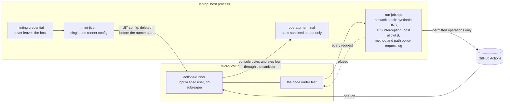

# Gondolin runner: design

The gondolin runner runs a pull request's CI suite inside a micro-VM on a Mac. The VM exists for one
job and is discarded afterwards. This document covers what the VM closes off, what it does not yet
close off, and the order in which the gaps close.

**Status.** It runs real suites end to end. It is contained against accidents and casual malice. It
is not yet safe against code that is actively trying to escape: [Gaps](#gaps) explains why, and
[Plan](#plan) sets out what closes them.

## Why it exists

A self-hosted runner on a laptop is capacity when hosted runners are unavailable, and an opt-in
workflow is careful about *authorisation*: nothing about a pull request starts a run, and the
definition that executes is the default branch's. It is not *isolated*, though. A plain runner
executes the job as the laptop's user, on the real filesystem, with that user's network. The
gondolin runner adds the isolation.

It is built on [gondolin](https://www.npmjs.com/package/@earendil-works/gondolin) 0.12.0, which runs
micro-VMs whose whole network stack is TypeScript inside the host process.

## How it works

The workflow picks its runner by label: `["self-hosted", "optin", "pr-<N>"]`. A VM that registers
under those labels is the runner the workflow already looks for.

Each run uses one VM. `run-optin.sh` mints a single-use (JIT, just-in-time) runner config, boots the
VM, and waits for GitHub to report the runner online. It then dispatches the workflow at the pull
request's commit and waits for the runner to exit, which happens on its own after one job. The disk
is a copy-on-write overlay, so everything the job wrote disappears with the VM.

The steps the operator sees come from inside the guest, because GitHub's step data can run minutes
behind the runner. The runner keeps its own account in `_diag/Worker_*.log`, flushed line by line,
so `run-job.mjs` follows that file as the job's user and writes one line to a steps file as each
step starts and ends. A step's output is a file under `_diag/blocks/` that the runner uploads and
deletes a second or two after the step ends, so when a step fails `run-job.mjs` reads its last lines
at once. `run-optin.sh` prints from the steps file and asks GitHub for one thing, the run's
conclusion.

## Threat model

The adversary is whoever wrote the code under test. They control every process in the guest, every
byte the job prints, and every request the guest sends. They do not control the default branch's
copy of the workflow, the dispatch, or anything on the host.

Two adversaries hold different positions, and the difference decides what a network policy can
achieve:

- **A dependency that cannot read the run's logs.** An example is a malicious package pulled in by
  a lockfile change, in a private repository. The network is its only way out. This is the likely
  case, and the one the egress policy is built for.
- **An author who can read the run's logs.** An example is a collaborator whose own pull request is
  the attack. Anything the job prints reaches them, obfuscated past GitHub's masking if needed. No
  proxy can close that channel, because a job has to be able to log.

What the adversary would want, most valuable first:

1. **The laptop account.** It holds SSH keys, the `gh` token, any GitHub App private key, and
   whatever else that user can read.
2. **The default branch's integrity.** Other jobs restore from its Actions cache scope, so a
   poisoned entry there runs in those jobs.
3. **The job's own credentials.** These are a `GITHUB_TOKEN` with `contents: read` on the whole
   repository, every branch included, and the job's `ACTIONS_RUNTIME_TOKEN`.
4. **The laptop's availability.**

Three things are out of scope:

- **Keeping the checkout secret from the code under test.** It is that code's own tree.
- **Side channels,** timing included.
- **The review before dispatch.** It is a real authorisation control, but not a containment layer.
  For adversarial code, assume the review missed it.

## What holds today

`node lane/probe-containment.mjs` checks the guest's side of these from inside a VM built exactly as
a real job's is, and `node --test` covers the policy and the sanitiser. The key and disk rows come
from `mint-jit.sh`, `run-job.mjs` and gondolin's `rootfs: { mode: "cow" }`.

| layer | what it does |
| --- | --- |
| no host filesystem | nothing of the host is mounted: `/Users` does not exist in the guest, and the mounts are an in-memory `/scratch` and gondolin's own in-memory `/etc/gondolin` |
| host allowlist | HTTP reaches the Actions hosts GitHub publishes (`allowlist.json`, refreshed by `refresh-allowlist.sh`) and 7 toolchain hosts (`allowlist-build.json`) |
| allowlist precedence | `isRequestAllowed` runs first and can only refuse; gondolin's own host check then runs ahead of any custom one, so no callback can widen the policy |
| no other protocol | non-HTTP TCP is reset; UDP is dropped unless it is port 53; WebSocket upgrades get `501`, because the policy never sees their frames |
| synthetic DNS | port 53 is answered in-process and never forwarded |
| method and path policy | `lib/egress.mjs` allows reads on any allowed host, and writes only where a rule names them; see the table below |
| no root in the guest | the image has no `sudo`; the runner starts as an unprivileged user with no way back |
| process memory | Yama `ptrace_scope` 2, and the job does not start unless the setting took |
| sanitised output | everything the guest prints passes `lib/terminal.mjs`, so a job cannot drive the terminal (OSC 52 writes the clipboard, CSI moves the cursor) |
| key stays home | the guest receives one JIT config, good for one job; the minting credential never enters it |
| disposable disk | a copy-on-write overlay per VM |

The egress policy is a pure function of `(method, host, path)`:

| hosts | allowed | refused |
| --- | --- | --- |
| Actions control plane (`*.actions.githubusercontent.com`) | the runner's own calls; on the user-facing results API, only `CacheService/GetCacheEntryDownloadURL` and `WorkflowStepUpdateService/WorkflowStepsUpdate` | the rest of that API, so every cache and artifact write; legacy `_apis/artifactcache` and `pipelines/workflows/*/artifacts` writes |
| results blob storage (`productionresultssa*`) | writes to an upload URL this job's control plane handed out through the proxy | any other write, including to an upload URL minted outside the proxy |
| `github.com` | `GET`, `HEAD`; `POST …/git-upload-pack` for the repository under test only | every other write, including `git-receive-pack` (push) |
| `registry.npmjs.org` | `GET`, `HEAD`; `POST` to npm's audit endpoints | publishing |
| every other allowed host | `GET`, `HEAD` | every write |

Every refusal is logged with its method and path and the rule that refused it. The report goes to a
file of its own rather than the job log, because guest output could print lines shaped like it.

## Gaps

Four gaps, most serious first. The first sits behind all the others.

**1. An escape lands in the operator's account, and nothing stands in the way.** QEMU, gondolin's
network stack and its TLS-intercepting HTTP proxy all run as the laptop's user with no confinement.
Every packet and HTTP request the guest sends is parsed in that host process. A bug in QEMU's
virtual devices or in gondolin's parsing therefore means code execution as that user, which reaches
everything in item 1 of the threat model. The VM is the only layer.

**2. The job holds a token that can write to the default branch's Actions cache.** The dispatch runs
on the default branch, so the job's `ACTIONS_RUNTIME_TOKEN` is scoped to that branch's cache. Every
later run can restore from it, including jobs that hold secrets. A poisoned tool binary would run
inside those jobs. Cache entries are immutable per key and scope, so an attack needs a key with no
entry yet, such as a version bump or a lockfile change.

The proxy refuses the cache write from inside the guest, which is the direct route for a dependency
that cannot read the logs. That narrows the route without closing it: the token is readable in
`/proc/<pid>/environ`, and the paths in gap 3 can carry it to a run the attacker controls, which
then writes the cache from outside. An author who can read the logs prints the token and uses it
while the job runs. Phase 2 closes both.

The refusal of forks follows from this gap and gap 1. A fork's author is the most hostile source of
code the lane would take, and exactly the adversary who can read the logs. The refusal stays until
Phases 2 and 3 have landed.

Public repositories are refused too, and refusing their forks' pull requests would not be enough. A
runner takes any job whose labels it carries, and every runner carries `self-hosted`. Anyone can
open a pull request from a fork with a workflow asking for that label alone, and if it is queued
when a VM comes online, the VM runs that workflow's own definition, with logs its author can read.
In a private repository only people with access can queue a job at all.

**3. The allowlist is by host, not by account.** Reads are unfiltered, and the Actions control
plane and results blob storage are shared by every GitHub customer. A write that carries a runtime
token from someone else's run is judged like this job's own, because nothing in
`(method, host, path)` tells them apart. So a dependency can send this job's token to an attacker's
run. An upload URL minted through the proxy with another tenant's token is recorded the same way.

**4. Side channels shaped as reads.** The paths of `GET` requests to a repository the attacker owns
show up in that repository's traffic statistics. Such channels are narrow, but a token fits through
one.

Resource abuse is capped by the VM's memory and CPU limits and by each job's `timeout-minutes`.

## Plan

**Enforce outside the guest.** Everything inside the VM belongs to the code under test as soon as
that code runs. The host-side proxy is the one layer it cannot reach, short of an escape.

### Phase 2: tokens never enter the guest (gaps 2 and 3)

Path rules cannot separate this job's control-plane credentials from anyone else's. Credentials can
be separated, though. Gondolin binds a secret to named hosts: the guest sees only a placeholder, and
the host substitutes the real value in requests to those hosts. Phase 2 applies that to the job's
own tokens as they arrive:

- The few control-plane calls that hand out tokens are made by the proxy itself, as the signed-URL
  calls already are. Each answer is rewritten so every token in it becomes a placeholder.
- Each placeholder keeps the token's JWT header and payload and replaces only the signature, because
  the actions toolkit reads the runtime token's claims client-side.
- Any control-plane request that carries a raw token, one with no placeholder behind it, is refused.

The runner's own registration stays exposed until then too. It starts with `--jitconfig`, so the
config is readable in `/proc/<pid>/cmdline` for the life of the job. That registration is bound to
this one job, which makes it worth less than the runtime token, but the commands that report on the
guest name processes by `comm` so that it never reaches the host's log.

A token printed to the logs is then a placeholder and worthless outside, and a token fetched from an
attacker's run has no placeholder, so it is refused. This needs a transcript of a live run first, to
show where tokens appear and how the runner's OAuth refresh behaves with a placeholder.

### Phase 3: confine the host side (gap 1)

The host process has to lose access to the operator's account.

| option | what an escape reaches | cost |
| --- | --- | --- |
| dedicated macOS user runs `node` and QEMU; `mint-jit.sh` stays with the operator and hands over only the JIT file | that user's empty home | a user account; the assets move to a shared path; each run goes through `sudo -u` |
| `sandbox-exec` profile around `node` and QEMU | whatever the profile allows | `sandbox-exec` is deprecated, and profile mistakes fail open |
| a separate machine with nothing on it | that machine | hardware, and the lane stops being on the laptop |

The dedicated user is the likely choice. Two things need checking before relying on it: macOS home
directories are often group- or world-readable, and a non-admin user may not have access to
Hypervisor.framework.

## Guest environment contract

A gondolin guest does not boot like a normal distribution: there is no udev and no systemd, and PID 1
is `sandboxd`. Six things a job takes for granted on `ubuntu-latest` therefore have to be set up by
hand, in `lib/guest.mjs`:

1. **Certificate path.** Gondolin points `NODE_EXTRA_CA_CERTS` at a root-only file, so Node actions
   running as the job user fail TLS. Point it and `SSL_CERT_FILE` at the system bundle.
2. **Writable temp.** `chmod 1777 /tmp /var/tmp`, with `HOME` and the XDG directories under
   `/home/runner`.
3. **`/dev/fd`.** devtmpfs has no `/dev/fd`, so every bash `<(...)` fails. Symlink `/dev/fd`,
   `/dev/stdin`, `/dev/stdout` and `/dev/stderr` to `/proc/self/fd`.
4. **`/dev/shm`.** It is a bare root-owned directory. Mount a tmpfs there, mode 1777, for Chromium.
5. **`PATH`.** The init's `PATH` lacks `/usr/local/bin`, which is where node and npm live.
6. **Reaping.** `sandboxd` never reaps orphaned processes, so a killed process stays a zombie and
   "has it exited?" checks never clear. Start the runner under `tini -s`.

## Invariants

These look like reasonable changes and are not:

- **Keep stripping `Expect: 100-continue`.** The .NET runner sends it, and undici, the HTTP client
  gondolin uses to reach the real host, refuses it. Without the `onRequest` hook, every runner
  request fails with a 502.
- **Never pass `VMOptions.fetch` on a real run.** A custom fetch skips gondolin's guarded DNS lookup,
  which pins each request to an address that passed the IP check.
- **Keep WebSockets off.** An upgrade is judged as the `GET` it starts with, and its frames pass
  unseen, so it would be a write channel the policy cannot read. `lib/proxy.mjs` keeps them off for
  the job and the probe alike.
- **Never install an `onResponse` hook.** With one installed, gondolin buffers every response instead
  of streaming it, and answers `502` to any over 64 MB, which a checkout's pack can be. A response
  the proxy must read is fetched by the proxy itself in `onRequest`, for that one call, after the
  policy has admitted it.
- **Keep DNS synthetic, and leave `ssh` and `tcp` egress unconfigured.** Gondolin's `trusted` and
  `open` modes forward DNS upstream, which opens a channel for data to leave.
- **Enforce in the proxy, not in the guest.** A rule the guest could switch off is not a rule.
- **Never print guest bytes except through the sanitiser.** Step names, step log lines and pull
  request titles count: `lib/steps.mjs` makes each step field plain text before it reaches the steps
  file.
- **Never put a credential on a command line, and never print `args` from the guest.** The App's
  token reaches `curl` through a file descriptor, and the guest's process listings use `comm`.
- **Take the verdict from GitHub, not from the steps file.** The job's user owns the runner's
  diagnostic log, so the code under test can write any step line it likes. `run-optin.sh` exits on
  the conclusion GitHub reports for the run GitHub named in its answer to this dispatch, and only
  when that run's job went to the runner this invocation minted.
- **Bound what the guest can make the host do.** The guest can forge any number of steps and failed
  steps. `lib/steps.mjs` writes at most `LIMITS.events` of them and reads the log of at most
  `LIMITS.failures`. `run-job.mjs` writes at most `GUEST_LOG_LIMIT` bytes of the console to the log.
- **Read the runner's logs as the job's user.** A root process that opened paths under `_diag` would
  follow whatever link the job left there.
- **Import the proxy and guest setup; never copy them.** `run-job.mjs` and the containment probe both
  build from `lib/proxy.mjs` and `lib/guest.mjs`. A probe that builds its own VM proves nothing about
  the real one.
- **The lane yields to the laptop's owner.** The VM runs in the background band whenever someone is
  using the laptop or other work wants the CPU (`lib/governor.mjs`).
- **One VM at a time, through the slot.** Anything that boots a VM takes `lib/slot.mjs`'s slot first
  and waits its turn.
- **Take readiness from GitHub, not from the log.** Poll the runner list until GitHub reports the
  runner online.
- **A human dispatches every run.** Each run comes from someone who read the commit. A loop that
  dispatches on its own removes that review, and with it the reason branches of the repository are
  the only code the lane accepts.
